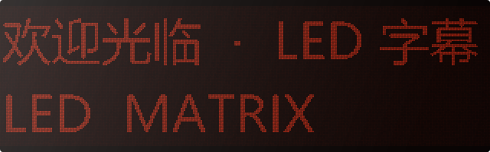
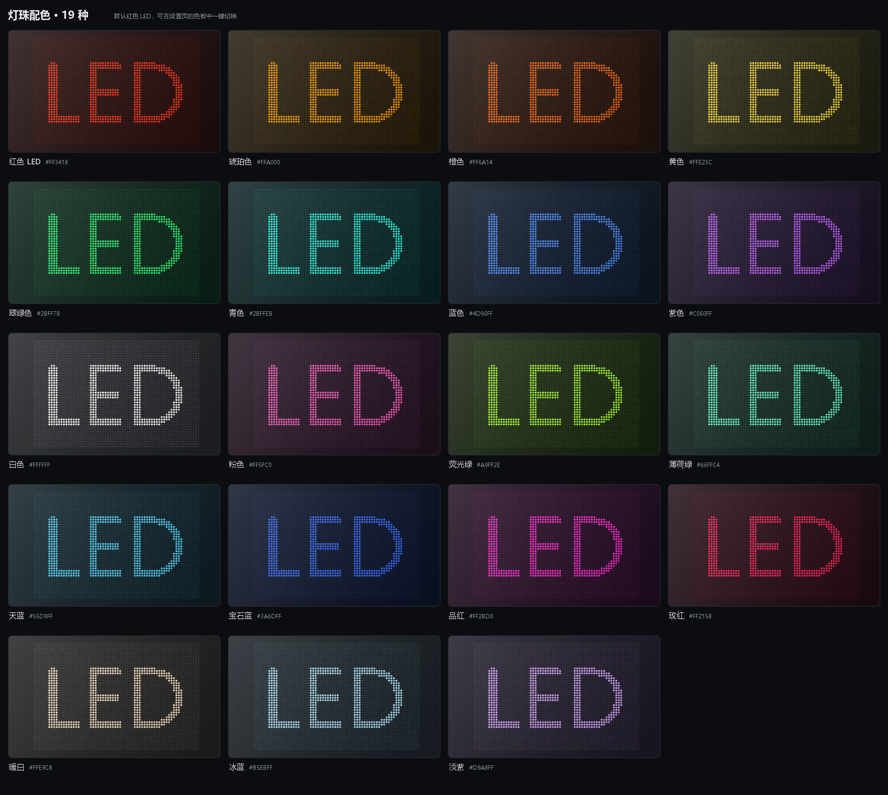

# LED 滚动字幕（Android 手机 / 平板）

仿 **红色 LED 点阵屏** 的滚动字幕显示应用。输入任意文字（支持中文、英文、符号、emoji），
即可在全屏 LED 点阵上滚动播放，适合门迎、展台、车机、平板、手机当电子牌使用。

[](https://github.com/CSN8079/led-marquee-android)
[](LICENSE)
[](https://github.com/CSN8079/led-marquee-android/releases/latest)

> A red LED dot-matrix scrolling marquee for Android phones & tablets — pure Java, zero dependencies, 19 LED colors.



*展示图参数：点阵字高 40 行 · 关闭辉光 · 显示未点亮灯珠*

- **纯 Java + Android Framework**，零第三方依赖（无 AndroidX / Kotlin / Material）
- 安装包仅 **约 206 KB**，冷启动快、兼容 Android 5.0 ~ 14
- 所有参数 **实时预览**，手机与平板自动适配

---

## 一、直接安装

| 项目 | 内容 |
| --- | --- |
| 最新版本 | **v1.1**（versionCode 2，可覆盖安装 v1.0） |
| 下载 | [**Releases → LED-Marquee-v1.1.apk**](https://github.com/CSN8079/led-marquee-android/releases/latest) |
| 签名 | v1 + v2 + v3 均已校验通过（自签名，供个人安装） |
| 应用包名 | `com.ledmatrix.marquee` |
| 最低系统 | Android 5.0（API 21） |
| 目标系统 | Android 14（targetSdk 34） |
| 屏幕 | 手机 / 平板 / 折叠屏 / 车机，支持横竖屏与分屏 |

安装方式：

1. 把 APK 传到手机（微信/QQ/USB/网盘均可），点击安装；
2. 首次安装需允许「安装未知来源应用」；
3. 若系统提示"存在风险"，属于自签名应用的正常提示。

> **签名说明**：Release 中的 APK 用项目本地生成的调试密钥签名，`.keystore/` 已在 `.gitignore` 中排除，不会进入仓库。
> 如需长期发布自己的版本，请用 `keytool` 生成你的密钥，并修改 `tools/build-apk.js` 顶部的 `KS_PASS` / `KS_ALIAS`。

---

## 二、使用方式

1. **输入字幕**：在设置页输入文字，可用回车换行（最多 6 行，每行最多 400 字）；
2. **调参数**：上方预览会实时显示效果；
3. **全屏播放**：点「全屏播放」或直接点预览区域；
4. **全屏操作**：
   - **单击** 屏幕：暂停 / 继续（可在设置里关闭）
   - **长按** 屏幕：呼出快捷控制条（速度、亮度、颜色、方向、回到开头、退出）
   - 快捷控制条 4.5 秒无操作会自动隐藏

全屏时默认隐藏状态栏/导航栏、保持屏幕常亮（均可在设置里修改）。

---

## 三、功能与参数

### 显示

| 参数 | 说明 |
| --- | --- |
| 字幕文本 | 最多 6 行；换行后每行独立成一条点阵行带 |
| 灯珠颜色 | 内置 **19 种**，设置页为可视化色板，点圆点即选 |
| 点阵字高 | 8 / 12 / 16 / 20 / 24 / 32 / 40 行灯珠。越高越细腻、可见字数越多 |
| 滚动速度 | 1 ~ 80 灯珠列 / 秒 |
| 亮度 | 15% ~ 160% |
| 滚动方向 | 从右向左（默认）/ 从左向右 |
| 滚动方式 | 灯珠步进（默认，真实 LED 板一格一格走）/ 平滑移动 |

### LED 灯板效果

| 参数 | 说明 |
| --- | --- |
| 灯光辉光 | 灯珠外圈柔光，模拟真实 LED 的发光散射 |
| 未点亮的灯珠 | 显示暗淡的灯珠底点，像真实点阵面板 |
| 灯珠亮度色差 | 每颗灯珠亮度略有不同，模拟灯板个体差异 |
| 面板模块网格 | 每 16×16 颗灯珠画一条拼接缝（真实 LED 模组感） |
| 玻璃反光 | 面板表面的斜向高光 |
| 笔画粗细 | 1（细）~ 5（粗），用于适配不同字体/字号下的点阵效果 |

### 播放行为

| 参数 | 说明 |
| --- | --- |
| 全屏方向 | 跟随系统 / 竖屏 / 横屏 |
| 左右镜像 | 适合玻璃反射、后视镜等场景 |
| 保持屏幕常亮 | 全屏时防止自动锁屏 |
| 全屏时点击暂停 | 关闭后单击不再暂停 |
| 恢复默认参数 | 保留当前文字与预设，其余参数复位 |

### 配色一览



红（默认）、琥珀、橙、黄、翠绿、青、蓝、紫、白、粉、荧光绿、薄荷绿、天蓝、宝石蓝、品红、玫红、暖白、冰蓝、淡紫。

*配色图同样使用：点阵字高 40 行 · 关闭辉光 · 显示未点亮灯珠*

### 常用语预设

可保存最多 20 条常用字幕；选中后点「载入」即可快速切换，适合门店反复使用。

所有设置保存在 `SharedPreferences`（文件 `led_marquee`），卸载应用后清除。

---

## 四、技术实现

核心渲染在 `LedMarqueeView.java`，整个流程为：

1. **文字 → 二值点阵**
   以 3 倍超采样绘制字形，再对每颗灯珠覆盖的 3×3 像素块求平均覆盖率并二值化。
   等价于「盒式低通滤波 + 阈值」，因此**不需要自带点阵字库**也能让中文笔画清晰，
   且任意系统字体、emoji 都能直接使用。
2. **静态图层预渲染**
   未点亮灯珠（8×8 重复贴图）、模块网格、渐晕、四边压暗合成一张背景位图，
   只在尺寸/配色/参数变化时重建；未亮灯珠网格通过 `Matrix` 与点亮灯珠严格同相位。
3. **逐帧绘制**
   每帧按滚动偏移把可见的点亮灯珠坐标收集到 3 个亮度桶，每个桶一次
   `Canvas.drawPoints`（圆头笔帽即圆点），再叠加辉光与灯珠本体。
4. **辉光（bloom）**
   在 1/8 分辨率的小位图上画大圆点，再双线性放大回全屏——比 `BlurMaskFilter`
   快得多、跨 GPU 更稳定，且能得到柔和的光晕。
5. **像素对齐**
   灯珠边长取整像素，滚动步进模式下偏移也取整，保证点阵永远落在整格上，
   不会出现半颗灯珠的"糊边"。

滚动循环使用 `Choreographer` 帧回调，按真实帧间隔积分位移，掉帧时速度仍然准确。

---

## 五、项目结构

```
.
├─ app/src/main/
│  ├─ AndroidManifest.xml
│  ├─ java/com/ledmatrix/marquee/
│  │  ├─ MainActivity.java      设置页（实时预览 + 参数面板 + 预设）
│  │  ├─ DisplayActivity.java   全屏播放页（沉浸式 + 快捷控制条）
│  │  ├─ LedMarqueeView.java    LED 点阵渲染核心
│  │  ├─ MarqueeConfig.java     参数模型与持久化
│  │  ├─ LedPalette.java        灯珠配色表
│  │  └─ Prefs.java             SharedPreferences / 预设存储
│  └─ res/                      主题、颜色、启动图标（含自适应图标）
├─ app/build.gradle.kts         Android Studio 构建配置（零依赖）
├─ tools/
│  ├─ build-apk.js              离线打包脚本（aapt2 + javac + d8 + apksigner）
│  ├─ make-icons.js             启动图标生成（Node 直接写 PNG）
│  ├─ inspect-apk.js            APK 产物自检
│  ├─ ziplib.js                 极简 ZIP 读写
│  └─ preview/LedPreview.java   桌面端点阵效果预览渲染
├─ docs/preview.png             效果预览图
├─ docs/colors.png              19 种配色一览
├─ LICENSE                      MIT 许可证
├─ CHANGELOG.md                 更新日志
└─ dist/                        本地构建输出（已在 .gitignore 中忽略）
```

---

## 六、用 Android Studio 构建

1. Android Studio（Koala 2024.1.1 或更新）→ **File → Open** → 选择本目录；
2. 首次同步会自动下载 Gradle 8.7 与 Android SDK Platform 34；
3. 运行 `app` 配置，或 **Build → Build Bundle(s)/APK(s) → Build APK(s)**。

工程是 AGP 8.5.2 + Gradle 8.7 + JDK 17、`compileSdk 34`、`minSdk 21`。
若本机没有 `gradle/wrapper/gradle-wrapper.jar`（本仓库未附带二进制），
Android Studio 会按 `gradle-wrapper.properties` 自动补全，或在 Terminal 执行一次
`gradle wrapper --gradle-version 8.7`。

---

## 七、离线命令行打包（不使用 Gradle）

如果本机已有 JDK 17 与 Android SDK（platform 34 + build-tools 34），可以完全不联网打包：

```powershell
# 可选：显式指定工具链目录
$env:LED_JDK = "C:\path\to\jdk17"
$env:LED_ANDROID_SDK = "C:\path\to\android-sdk"

node tools/build-apk.js
```

脚本会自动完成：资源编译 → APK 链接 → Java 编译 → d8 生成 dex →
合包 → zipalign → 签名 → 校验，并输出到 `dist/`。

> 构建中间目录会自动选择纯英文路径（Windows 下 aapt2 无法处理中文路径）。

重新生成图标：`node tools/make-icons.js`
重新生成效果预览：见 `tools/preview/LedPreview.java` 顶部注释（需要桌面 JDK）。

---

## 八、说明与限制

- 本项目定位是**本地显示工具**：不做联网、不做远程控制、不申请任何权限；
- 全屏常亮依赖 `FLAG_KEEP_SCREEN_ON`，无需额外权限；
- 单条字幕最多 6 行、每行 400 字，超长内容会被截断（避免点阵位图过大）；
- 点阵是"二值"的：灯珠只有亮/暗两种状态，靠密度与辉光表现笔画，
  这正是真实单色 LED 屏的成像方式；
- APK 使用自签名证书，仅供个人/内部使用；如需上架应用商店，请替换为你自己的正式签名。

---

## 九、许可证

本项目基于 [MIT License](LICENSE) 开源，可自由修改、商用与二次分发。